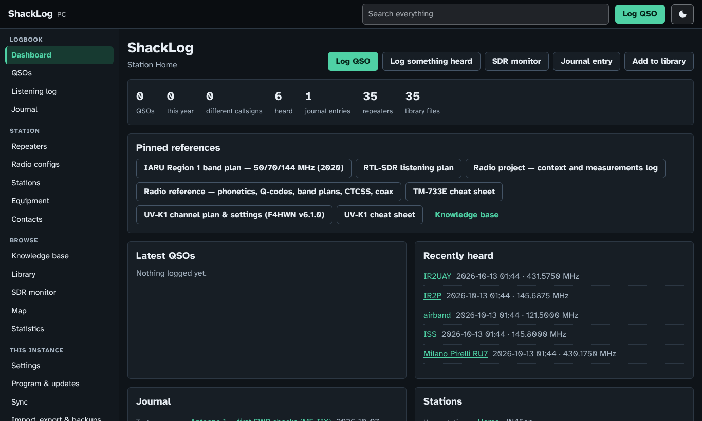
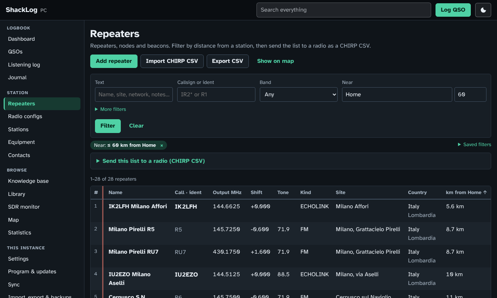
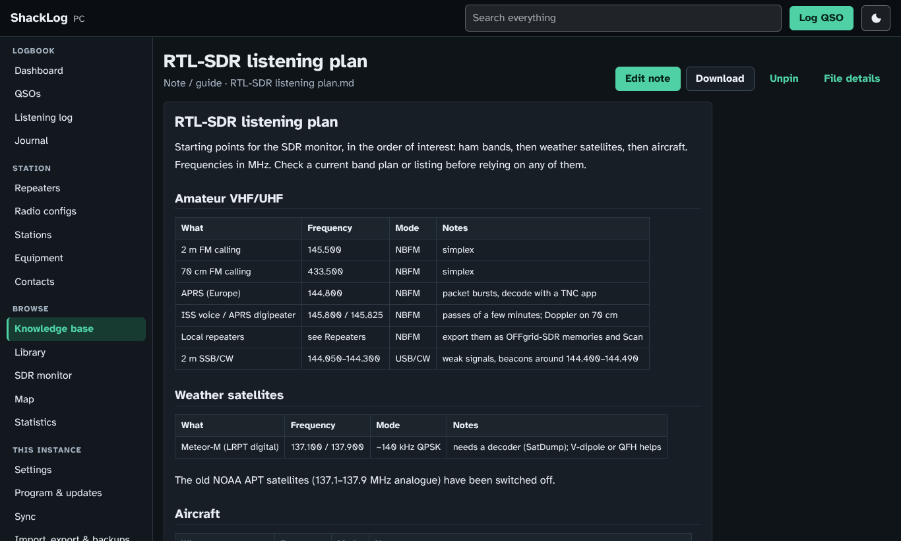
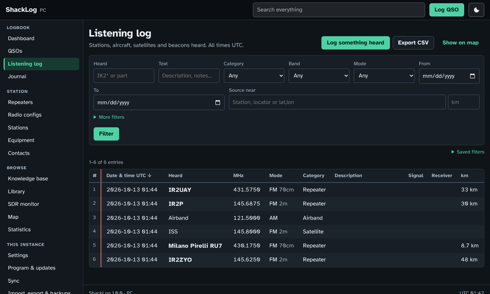
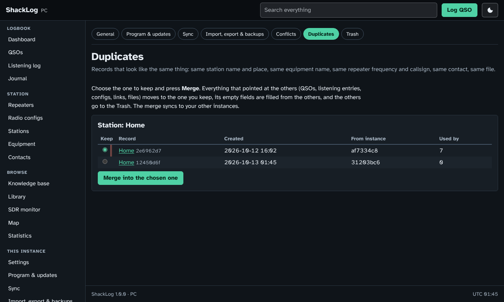
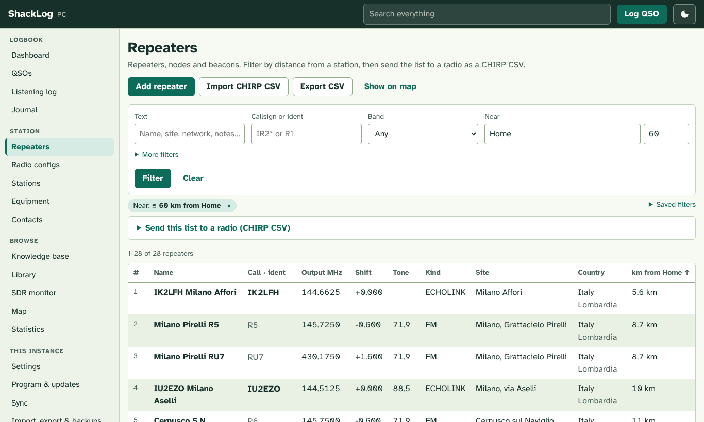
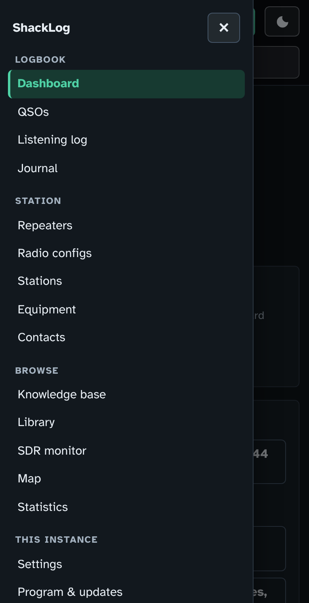

# ShackLog

**A personal amateur-radio logbook, station archive and document library, built to keep
everything for decades.**

It is a single program for Windows, Linux and macOS, and you use it in the browser. The
same code runs as a **hub** on a home server (a dedicated Proxmox container) that every
PC syncs with and that your phone can browse.



## What it does

| | |
|---|---|
| **Logs** | QSOs (ADIF in/out), listening log (SWL), antenna & test journal with NanoVNA sweep plots, station diary. All times UTC. |
| **Station** | Repeaters (CHIRP CSV, RepeaterBook and national lists import, *export the repeaters within N km as a CHIRP channel list*), radio configurations (every CHIRP image kept, channels parsed and diffed), stations, equipment, contacts. Anything can be linked to anything. |
| **On the air** | Typing a callsign shows its country, zones and beam heading from your station (AD1C's country list), *worked before* and *new country*, and the callbook entry (HamQTH or QRZ.com) with one click to fill in name, QTH and locator. |
| **QSL cards** | What to send, printable address labels, cards out, cards back, with the scans of the card linked to the QSOs. |
| **Find anything** | Full-text search, including inside PDF manuals. Filters by callsign (wildcards), repeater, radio, antenna, band, mode and dates, plus distance from any station or locator. Saved filters, a map that works offline (tile cache, MBTiles files), statistics, a page per callsign. |
| **Knowledge base** | Markdown notes written in the browser, quick references, manuals, band plans. Pin the ones you use to the dashboard. |
| **SDR monitor** | [OFFgrid-SDR](https://github.com/diddy-boy/OFFgrid-SDR), a WebUSB RTL-SDR receiver, next to a one-click listening log. It exports your repeaters as OFFgrid-SDR memories so you can scan for activity. |
| **Sync** | Every PC keeps a full copy and the hub collects everything. Conflicting edits are kept, never dropped. Bundles (one zip) cover machines with no network. |
| **Keep it forever** | Trash instead of hard deletes, a daily backup plus one before every import (optionally mirrored to OneDrive or a NAS), duplicate finder and merge. |
| **Comfortable** | Dark night theme by default with a light switch, side menu (a drawer on phones) showing which instance you're on (name, IP, port), runs in the background on Windows with a tray icon. |
| **Self-updating** | PCs update from GitHub at start when online; the hub checks every 6 hours and can install updates by itself, with rollback. |

| Repeaters near home, ready for the radio | Knowledge base |
|---|---|
|  |  |
| **Listening log** | **Merging duplicates after a first sync** |
|  |  |
| **Light theme** | **Phone** |
|  |  |

## Get started

### Windows PC

**Option A: download.** Get `ShackLog.exe` from the latest
[release](../../releases), or from *Actions › build › Artifacts* (every push builds it).
Put it in a folder and double-click it.

**Option B: from git, so the program can update itself** (recommended):

```bat
winget install Git.Git
winget install Python.Python.3.13
git clone https://github.com/Phoenix1o1/shacklog.git
shacklog\packaging\build_windows.bat
```

`dist\ShackLog.exe` is the program. From then on it **updates itself**: at every start,
if you're online, it checks GitHub and pulls, tests, rebuilds and restarts when there's
something new (turn this off in *Settings › Program & updates*, which also has
**Update now**).

ShackLog has **no window**. It starts in the notification area next to the clock (click
**^** if the icon is hidden) and opens the browser at `http://127.0.0.1:8573/`.
Right-click the icon to open it, open the data folder, **Start when I sign in**, or quit.
Closing the browser doesn't stop it.

### Linux / macOS

```bash
git clone https://github.com/Phoenix1o1/shacklog.git && cd shacklog
python3 -m venv .venv && .venv/bin/pip install -r requirements.txt
.venv/bin/python -m shacklog          # opens the browser; Ctrl+C stops it
```

Or build an executable with `packaging/build_unix.sh`.

### The hub on Proxmox

On the Proxmox host, in a clone of the repository:

```bash
bash deploy/proxmox/shacklog-lxc.sh
```

A guided script in the style of the Proxmox VE Helper Scripts creates a dedicated
unprivileged Debian container (1 core, 512 MB, 8 GB by default), installs ShackLog as a
service, and can restore your data and schedule vzdump backups to your NAS. Then open
`http://<container-address>:8573/`, enter the setup code it printed, and choose a
password. Everything else (updates, `shacklog-ctl`, uninstall, backups, HTTPS) is in
**[deploy/PROXMOX.md](deploy/PROXMOX.md)**.

Docker works too: `docker compose -f deploy/docker/docker-compose.yml up -d --build`.

### Connect the PCs to the hub

1. On the hub, go to *Settings › Sync*, tick **Accept sync**, then **Generate token**.
2. On each PC, go to *Settings › Sync*, enter the hub address and the token, then
   **Test connection** and **Sync now**.
3. Saw something twice after the first sync, such as two *Home* stations? Go to
   *Settings › Duplicates* and press **Merge**.

## Where your data lives

| System | Folder |
|---|---|
| Windows | `%LOCALAPPDATA%\ShackLog` |
| Linux | `~/.local/share/ShackLog` |
| macOS | `~/Library/Application Support/ShackLog` |
| Hub | `/var/lib/shacklog` in the container |

The folder holds `shacklog.sqlite3` (the database), `files/` (the library) and `backups/`.
*Settings › Program & updates* shows the folder and opens it, and `ShackLog where --open`
does the same. For a USB-stick install, create a `ShackLogData` folder next to the
executable. Keep the live database out of OneDrive/Dropbox; mirror the *backups* there
instead (*Settings › Program & updates › Second copy of backups*).

## Commands

```
ShackLog                      desktop mode (default)
ShackLog serve                server mode (the hub)
ShackLog sync                 sync once with the configured hub
ShackLog import FILE          ADIF, bundle (.zip) or database file
ShackLog export-bundle OUT    database + all library files in one zip
ShackLog backup | info | set-password
ShackLog where [--open]       print (or open) the data folder
```

## Documentation

| | |
|---|---|
| [User guide](shacklog/help/user-guide.md) | Everyday use (also under **Help** in the app) |
| [deploy/PROXMOX.md](deploy/PROXMOX.md) | The hub: container, `shacklog-ctl`, updates, backups, uninstall |
| [CHANGELOG.md](CHANGELOG.md) | What changed in each version |
| [PLAN.md](PLAN.md) | Architecture, data model, sync protocol, roadmap |
| [MANDATES.md](MANDATES.md) | Project directives |
| [CONVENTIONS.md](CONVENTIONS.md) | How the code is written; how to add a section |
| [Credits & licences](shacklog/help/credits.md) | Third-party software, including OFFgrid-SDR |

## Development

```bash
pip install -r requirements.txt -r requirements-dev.txt
python -m shacklog --no-browser   # http://127.0.0.1:8573/
python -m pytest -q               # the tests (also run by CI on Python 3.11, 3.13, 3.14)
```

Plain Flask + SQLAlchemy + SQLite. There's no JavaScript build step: htmx and Leaflet are
vendored. Adding a section means adding one view module and one template folder (see
CONVENTIONS.md). Schema changes go through `shacklog/migrations.py`, and the database is
created or upgraded at every start.

## Credits

The SDR monitor is built around **[OFFgrid-SDR](https://github.com/diddy-boy/OFFgrid-SDR)**
by diddy-boy, which builds on Jacobo Tarrío's webrtlsdr and signals libraries. ShackLog
doesn't include it: you download it from its author and ShackLog serves your copy
locally. Full list: [Credits & licences](shacklog/help/credits.md).
